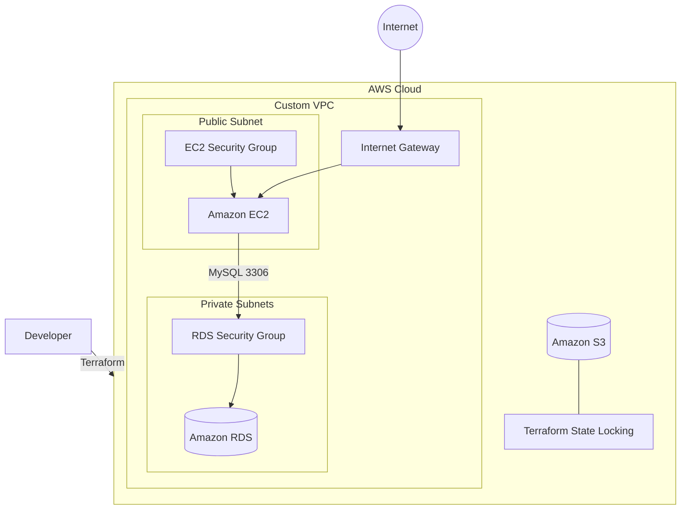

# 🚀 Enterprise AWS Cloud Infrastructure Automation Using Terraform

## 📌 Project Overview

This project demonstrates the provisioning and management of AWS cloud infrastructure using **Terraform (Infrastructure as Code)**.

Instead of manually creating AWS resources through the AWS Management Console, this project uses reusable Terraform modules to provision and manage cloud infrastructure in an automated and organized manner.

The infrastructure includes networking, compute, database and remote state management components.

### 🎯 Project Objectives

- Automate AWS infrastructure provisioning using Terraform.
- Create a custom Virtual Private Cloud (VPC).
- Organize infrastructure using reusable Terraform modules.
- Deploy an EC2 instance in a public subnet.
- Provision an Amazon RDS database in private subnets.
- Configure security groups for controlled communication.
- Configure an S3 remote backend for Terraform state management.
- Implement remote state locking.

---

## 🏗️ AWS Architecture

The following diagram represents the intended infrastructure design.



### Architecture Explanation

| Component        | Purpose                                            |
| ---------------- | -------------------------------------------------- |
| Amazon VPC       | Provides an isolated AWS network                   |
| Public Subnet    | Hosts the EC2 instance                             |
| Private Subnets  | Used for database infrastructure                   |
| Internet Gateway | Enables internet connectivity for public resources |
| Security Groups  | Control inbound and outbound traffic               |
| Amazon EC2       | Provides cloud compute capacity                    |
| Amazon RDS       | Managed relational database                        |
| Amazon S3        | Stores Terraform remote state                      |
| State Locking    | Prevents conflicting Terraform state operations    |

---

## 🛠️ Technologies Used

| Technology      | Usage                   |
| --------------- | ----------------------- |
| Terraform       | Infrastructure as Code  |
| AWS VPC         | Network isolation       |
| AWS EC2         | Compute infrastructure  |
| AWS RDS         | Database infrastructure |
| AWS S3          | Remote Terraform state  |
| Security Groups | Network security        |
| Git             | Version control         |
| GitHub          | Source code management  |
| VS Code         | Development environment |

---

## 📂 Project Structure

```text
aws-terraform-infrastructure/
│
├── Remote_backend/
│   ├── main.tf
│   ├── output.tf
│   ├── provider.tf
│   ├── terraform.tf
│   └── variable.tf
│
├── modules/
│   ├── vpc/
│   ├── security_group/
│   ├── ec2/
│   └── RDS/
│
├── .gitignore
├── .terraform.lock.hcl
├── backend.tf
├── main.tf
├── provider.tf
├── terraform.tf
└── variable.tf
```

### Terraform Configuration Files

| File                | Description                                    |
| ------------------- | ---------------------------------------------- |
| main.tf             | Connects and configures infrastructure modules |
| provider.tf         | Configures the AWS provider                    |
| backend.tf          | Configures the S3 remote backend               |
| terraform.tf        | Defines Terraform and provider requirements    |
| variable.tf         | Defines configurable input variables           |
| .terraform.lock.hcl | Locks provider dependency versions             |

---

## 📦 Terraform Modules

The project follows a modular architecture.

### 1. VPC Module

Responsible for provisioning the network foundation.

- Custom VPC
- Public subnet
- Private subnets
- Networking components
- Subnet outputs for other modules

### 2. Security Group Module

Responsible for defining security rules.

- EC2 security group
- SSH access configuration
- Application access rules
- Security group integration

### 3. EC2 Module

Responsible for provisioning the compute instance.

- EC2 instance
- Instance type configuration
- Public subnet integration
- Security group attachment
- SSH public key configuration

### 4. RDS Module

Responsible for provisioning the database infrastructure.

- Amazon RDS instance
- Private subnet integration
- Database username and password variables
- EC2 security group integration

---

## ☁️ Terraform Remote Backend

This project uses an Amazon S3 bucket as a remote backend to store Terraform state.

### Why use a remote backend?

Terraform state keeps track of the resources managed by Terraform.

Storing state remotely provides:

- Centralized state management
- Persistent state storage
- Easier collaboration
- State locking to prevent concurrent modifications

The backend configuration uses:

```hcl
terraform {
  backend "s3" {
    bucket       = "YOUR-TERRAFORM-STATE-BUCKET"
    key          = "terraform-project/terraform.tfstate"
    region       = "your region"
    encrypt      = true
    use_lockfile = true
  }
}
```

**Note:** Replace the bucket name with your own existing S3 bucket. The bucket must exist before initializing the main Terraform configuration.

The `Remote_backend` directory contains a separate Terraform configuration for provisioning the backend infrastructure.

---

## ⚙️ Prerequisites

Install the following tools:

1. AWS CLI
2. Terraform
3. Git
4. Visual Studio Code

Configure AWS credentials:

```bash
aws configure
```

Verify installations:

```bash
aws --version
terraform --version
git --version
```

---

## 🚀 Deployment Instructions

### Step 1: Clone the repository

```bash
git clone https://github.com/Ajaylogaom1/aws-terraform-infrastructure.git
```

Navigate into the project:

```bash
cd aws-terraform-infrastructure
```

### Step 2: Configure variables

Create your own `terraform.tfvars` file locally.

Example values (adjust names to match the variables defined in your project):

```hcl
aws_region  = "region"
project_name = "my-aws-project"
```

Provide sensitive values such as database credentials and SSH public keys securely.

Never upload your actual `terraform.tfvars` file to GitHub.

### Step 3: Initialize Terraform

```bash
terraform init
```

### Step 4: Validate configuration

```bash
terraform validate
```

### Step 5: Review execution plan

```bash
terraform plan
```

### Step 6: Provision AWS infrastructure

```bash
terraform apply
```

Review the proposed resources and confirm when ready.

---

## 🔐 Security Best Practices

- Use Terraform variables instead of hardcoding credentials.
- Never upload AWS access keys to GitHub.
- Keep Terraform state files out of version control.
- Restrict SSH access to trusted IP addresses.
- Keep the RDS database inaccessible from the public internet.
- Allow database traffic only from the required EC2 security group.
- Use encrypted remote state storage.
- Use IAM permissions following the principle of least privilege.


## 🎓 Key Learnings

Through this project, I gained practical experience with:

- Infrastructure as Code using Terraform
- AWS networking and VPC architecture
- Public and private subnet configuration
- EC2 and RDS integration
- Security group configuration
- Modular Terraform architecture
- S3 remote backend configuration
- Terraform state locking
- Git and GitHub version control

---

## 👨‍💻 Author

**Ajay**

Cloud & DevOps Enthusiast

GitHub: [@Ajaylogaom1](https://github.com/Ajaylogaom1)

Project Repository: [AWS Terraform Infrastructure](https://github.com/Ajaylogaom1/aws-terraform-infrastructure)

---

⭐ If you find this project useful, feel free to explore the repository and provide feedback.
